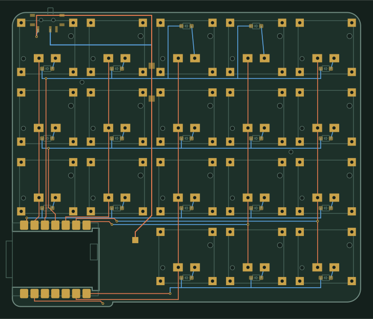
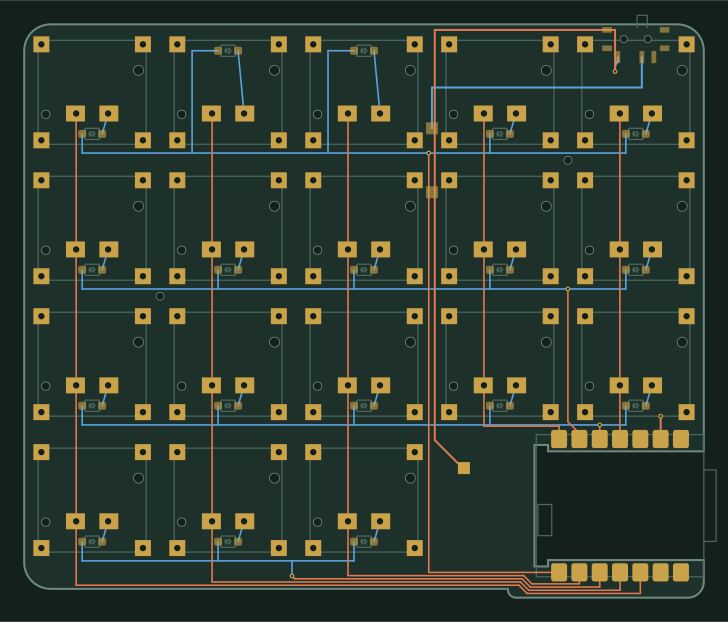
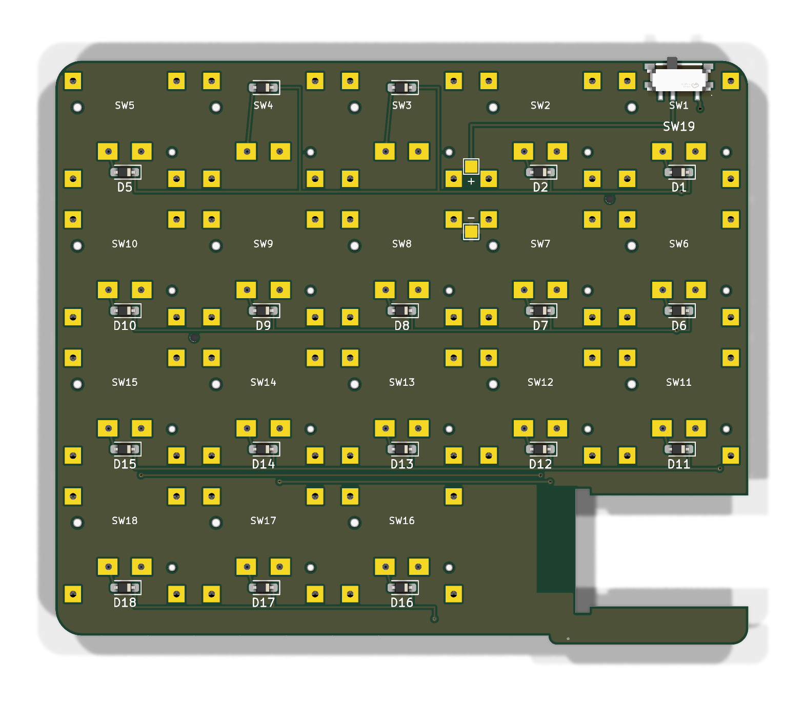
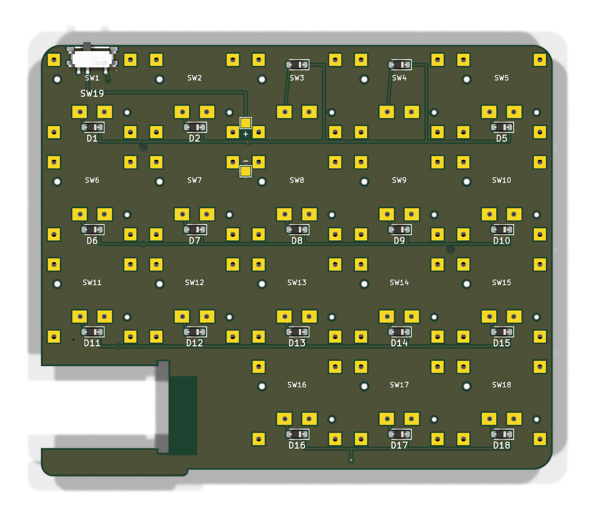

# 02 — PCB design (KiCad → fab)

Workflow: design straight in **KiCad**, with two projects, one per half. The right board is a mirror-image layout of the left; it is not the same board flipped over. KiCad handles placement, routing, DRC, and export. The fab is **JLCPCB** (or PCBWay).

## 1. Tooling setup
- **KiCad 10** (10.0.7 is installed in `/Applications/KiCad`). `kicad-cli` is linked into `~/.local/bin` for headless DRC, export, and footprint/symbol upgrades.
- **easyeda2kicad** (`uv tool install easyeda2kicad`) pulls footprints, symbols, and 3D models for LCSC parts: `easyeda2kicad --lcsc_id C431540 --full`.
- Optional: the KiCad MCP server (see [resources](resources.md#mcp--ai-tooling)).

## 2. Footprints
The project library is [`hardware/pcb/lib/`](../../hardware/pcb/lib/README.md). It lists every source and how each part was checked.

| Part | Footprint | Notes |
|---|---|---|
| PG1316S switch | `keeb:SW_Kailh_PG1316S_ViaInPad` | Datasheet land pattern, with plated holes in every pad. Frame pads have no net. The courtyard is the keycap outline, so DRC catches cap collisions |
| Diode SOD-323 | `Diode_SMD:D_SOD-323_HandSoldering` (stock KiCad) | On B.Cu |
| XIAO nRF52840 | `keeb:XIAO_nRF52840_FaceDown` | Castellated pads only, with the pin order mirrored for face-down mounting. A cutout guide is on Dwgs.User; draw the real opening on Edge.Cuts, open to the board edge at the USB-C end. Its size comes from Seeed's parts envelope. A rule area keeps copper off the board past the antenna end |
| Case locating pin | `keeb:Post_Locating_D1.0` | Ø1.0 mm NPTH at a four-key corner. The B.CrtYd circle is the support post, so diodes stay clear |
| Power switch | `keeb:SW_Slide_MSK-12C02` | From LCSC C431540. Mounted on B.Cu; the 1.4 mm body hangs into the 1.9 mm cavity |
| Battery | Bare solder pads (stock `TestPoint` pads) | Thinner than a connector |

**Switch footprint requirements (decided):**
- **Vias in the pads.** A plated hole goes through every PG1316S pad, including the frame pads, as on the Holykeebs practice board and in chalk. You solder each switch from the back with an iron.
- **Frame pads have no net.** They are mechanical only.

## 3. Projects and placement
The projects are [`hardware/pcb/left/`](../../hardware/pcb/left/) and [`hardware/pcb/right/`](../../hardware/pcb/right/). [`hardware/pcb/generate.py`](../../hardware/pcb/generate.py) created them: schematic, placement, outline, keep-outs and design rules. It is a one-time bootstrap, so it refuses to overwrite the projects unless you pass `--force`, which discards any routing. [`hardware/pcb/route.py`](../../hardware/pcb/route.py) then routes both boards (section 4). Run both with KiCad's Python (the command is at the top of each script).

Historical design notes report (not revalidated during repository reorganization): ERC has no violations, and DRC with schematic parity finds no unconnected items and no errors. The only warnings are four expected ones from the power switch's pegs (see the power-switch item below).

- **Library tables:** each project maps `keeb` to `${KIPRJMOD}/../lib/keeb.pretty` and `keeb.kicad_sym`. The stock libraries come from KiCad's global tables.
- **Schematic** (the same in both projects): SW1–SW18 (`Switch:SW_Push`, PG1316S) and D1–D18 (`Device:D`, 1N4148WS) in the 5 × 4 col2row matrix; U1 (`keeb:XIAO_nRF52840`) on each half's own [GPIO map](01-layout.md#gpio-map-as-routed); SW19, the power switch; TP1–TP3, the battery and XIAO wire pads; H1–H2, the locating holes. The XIAO's 3V3, 5V and two spare GPIO are no-connect (D9 and D10 on the left, D0 and D1 on the right). Its GND pin is on the GND net. The schematics differ only in the XIAO's pin labels.
- **Grid:** 17.0 mm, no stagger, origin at the centre of key (0, 0), which is also the CAD model's origin. Rows 0–2 use all 5 columns, and row 3 holds the thumbs in columns 2–4. The right board mirrors every position about the middle column. The switches keep their footprint orientation there, and the XIAO is rotated 270° instead of mirrored, so its D0 side faces the bottom edge.
- **Outline:** 85 × 70.6 mm with 3.3 mm corners (the tray's inner corner radius less the 0.2 mm clearance). The bottom edge sits 2.6 mm below the key grid. Under the XIAO, a 1.1 mm-deep tab runs from the outer edge to 16 mm past the key-(0,0) centre (1 mm and 2 mm corners). The XIAO cutout opens at the USB-C edge.
- **Why the board grew:** the XIAO's far pad row sits on a strip of board boxed in by the cutout, the board edge and the antenna keep-out. Its pads are 0.54 mm apart, too close for a track between them. On the right board that strip holds D0–D6, and five of those pins are needed. The grown edge and tab leave room for up to five tracks to fan out on F.Cu under the strip, with no vias in the XIAO's pads.
- **XIAO:** columns 0–1 of row 3 (columns 3–4 on the right board), USB-C flush with the outer edge, 0.7 mm below the row centre so its courtyard clears the row-2 caps.
- **Diodes** on B.Cu, 5.2 mm below each switch centre, with the anode toward the switch's pad 2. That keeps them between the contacts and the bottom frame pads, clear of the centre post. The keys over the battery, (2,0) and (3,0), have their diodes (D3, D4) 5.2 mm *above* the switch centre instead, clear of the pocket.
- **Power switch** (SW19) on B.Cu at the top edge under key (0,0), the outer top corner, with its body edge 0.5 mm in from the board edge. The nub sticks out 1.1 mm past the edge into a slot in the tray's top wall. Its two plastic pegs sit just inside the PG1316S outline, so DRC warns about the holes being inside SW1's courtyard and under its silk outline. The pegs reach only 0.5 mm into the 0.8 mm board (measured on the LCSC 3D model), so they stop 0.3 mm short of the key switch. These four warnings are expected.
- **Pads:** TP1 (BAT+) and TP2 (BAT−) on B.Cu in the column gap beside the battery pocket, marked + and − on the silk. TP3 on F.Cu in the empty row-3 slot, marked BAT+, is the wire to the XIAO's BAT+ back pad.
- **Keep-outs** (B.Cu rule areas that keep footprints out; DRC checks them): the battery pocket (20 × 30 mm placeholder plus 0.2 mm clearance) and a Ø2.4 mm circle for each case support post, one under each key centre except over the battery.
- **Antenna keep-out** (in the XIAO footprint, both layers, no copper at all): the 5 mm past the XIAO's antenna end, across the antenna chip's width plus 5 mm on one side and 4.25 mm on the other. It no longer covers the XIAO's full width, so the fan-out tracks can pass beside it.
- **Locating holes** (H1, H2): `Post_Locating_D1.0` at the four-key corners between keys (0,0)–(1,1) and (3,1)–(4,2), mirrored on the right board.
- **Snap-lip edges:** the tray's lip overlaps the PCB by 0.3 mm along the top and bottom edges. Keep parts at least 0.5 mm, and copper at least 0.3 mm (the lip's overlap), from those edges. The closest is the right board's deepest fan-out track, 0.36 mm from the bottom edge. The bottom lip starts 0.5 mm past the tab.
- **Design rules** (in each `.kicad_pro`): 0.8 mm board, 0.2 mm clearance, 0.3 mm copper to edge. The Default netclass uses 0.2 mm tracks and 0.6/0.3 mm vias. A Power netclass (BAT+, VBAT, GND) uses 0.25 mm tracks.

## 4. Routing (done)
`hardware/pcb/route.py` routes both boards from explicit paths and refills a GND pour on B.Cu. A rerun deletes any tracks and redoes them, so stop using it once you hand-edit routing in KiCad. Tracks are 0.2 mm for signals and 0.25 mm for BAT+ and VBAT. GND is 0.2 mm where it squeezes through the fan-out. Vias are 0.6/0.3 mm.

- **Columns** run down F.Cu through the gap between each switch's two contacts. **Rows** run along B.Cu 7.6 mm below each key centre, between the frame pads and the next row's. Each diode's anode goes straight up to its switch's pad 2, and its cathode goes down to the row.
- **XIAO key-side pads** are fed from above. Rows rise to F.Cu through a via on their row line and come down the gap between a column-0 switch's contacts, or a column gap. Columns from the far side come in as a bundle of up to three tracks over the top of the pads. On the left board, COL3 and COL4 cross COL2 on B.Cu between rows 2 and 3.
- **Fan-out:** the strip's nearest pad leaves at pad level. The others drop under the strip, nearest pad shallowest, so nothing crosses. They pass beside the antenna keep-out and run along the bottom edge on F.Cu to their column or row.
- **Power:** BAT+ runs on B.Cu from TP1 to the switch at the top edge. VBAT runs from the switch along the top edge on F.Cu and down a column gap to TP3.
- **GND:** B.Cu pour, tied to the XIAO's GND pad by one via. There's no F.Cu pour, because the columns and fan-out would cut it into islands. Copper stays out of the antenna keep-out.
- **Historical DRC claim (no saved report):** both boards report 0 unconnected items, 0 schematic parity issues, and only the four expected power-switch peg warnings. Before ordering, check the routing in the 3D viewer and against the case features: locating holes, post keep-outs, and the lip edges.

| Left | Right |
|---|---|
|  |  |
|  |  |

Top row: copper seen from the top, F.Cu in orange and B.Cu in blue, with the GND pour left out. Bottom row: KiCad's 3D render of the back. Regenerate them with [`hardware/pcb/render.py`](../../hardware/pcb/render.py) (KiCad's Python) after any routing change.

## 5. Footprint checks without the parts
Each footprint that could scrap the order was compared against at least one independent source. The details are in [`hardware/pcb/lib/README.md`](../../hardware/pcb/lib/README.md).

| Footprint | Checked against | Result |
|---|---|---|
| XIAO, face-down | Seeed's v1.1 KiCad layout and STEP model; chalk's back-mounted XIAO footprint (a built, working board) | Pin order agrees with chalk: D0 top-right at the USB-C end, 5V top-left, GND second on the left, D7 bottom-left. 2.54 mm pitch, rows ±7.62 mm |
| MSK-12C02 | The manufacturer's recommended land pattern (datasheet, LCSC C431540); JLCPCB's own EasyEDA footprint | Within 0.1 mm. Pins at −2.25 / −0.75 / +2.25 (footprint turned 180°), tabs to ±4.2, Ø0.85 peg holes |
| PG1316S | The Kailh datasheet and six community footprints | Matches the datasheet. The contact position is still disputed between sources (±2.5 vs chalk's ±1.5); the pads are widened to cover both |
| SOD-323 diode | Stock KiCad footprint | Standard part |

Still worth doing with real parts: look at the underside of one of your switches to settle the contact position, and lay a XIAO on a 1:1 print. Both cost nothing but a printout.

## 6. Order
[`hardware/pcb/fab.py`](../../hardware/pcb/fab.py) (KiCad's Python) writes everything JLCPCB needs to `exports/pcb/<side>/`:

| File | What it is |
|---|---|
| `<side>-gerbers.zip` | Copper, mask, paste, silk and outline Gerbers, and PTH / NPTH drill files. Upload this first |
| `<side>-bom.csv` | Parts list for assembly: 18 × 1N4148WS (C2128, basic part) and 1 × MSK-12C02 (C431540, extended part) |
| `<side>-cpl.csv` | Placement file for those 19 parts, all on the bottom side |

Only parts with an `LCSC` field go into the BOM and CPL. `generate.py` sets that field from the part's value, so the switches, the XIAO and the battery stay hand-soldered.

Order each board separately (left, then right):
1. Upload `<side>-gerbers.zip`. Set **2 layers, 0.8 mm, quantity 5**. Check the preview: the outline, the XIAO cutout and the tab under it must all come through.
2. Turn on **PCB Assembly**, and choose **Bottom side** and an assembly quantity (2 is enough; you need 1).
3. Upload `<side>-bom.csv` and `<side>-cpl.csv`. Confirm the two parts match and are in stock.
4. **Check the placement preview.** The diode's cathode band must line up with the bar on the silkscreen, and the power switch's nub must face the board edge. If one is rotated, fix it in the preview; JLCPCB also has a person check it.

**Economic or Standard assembly.** Economic is the cheap option, but at 0.8 mm it only offers green solder mask with HASL. Standard allows ENIG and any colour, but costs more. This board just clears Standard's 70 × 70 mm minimum. ENIG pads are flatter, which helps the switches sit level, but the switches are hand-soldered through plated holes, so HASL should be fine. Economic is the sensible first order.

## Checklist
- [x] Footprint pads match the datasheet (14.70 × 14.00 extents, contacts 5.00 mm centre to centre)
- [ ] Switch contact position confirmed on a real switch
- [x] All 18 switches per half are on unique row/col nets
- [x] Diode orientation is consistent (col2row) on both boards
- [x] The XIAO's 5V and 3V3 pads are left unconnected; GND is on the GND net
- [x] XIAO pin order agrees with an independent face-down footprint (chalk)
- [x] The XIAO cutout clears the measured components and USB-C
- [x] The power switch is in series with BAT+, and its footprint matches the datasheet land pattern
- [x] The antenna keep-out is respected
- [x] DRC is clean on both boards
- [ ] 1:1 paper print checked with a switch and a XIAO
- [ ] JLCPCB placement preview checked: diode polarity and switch orientation
