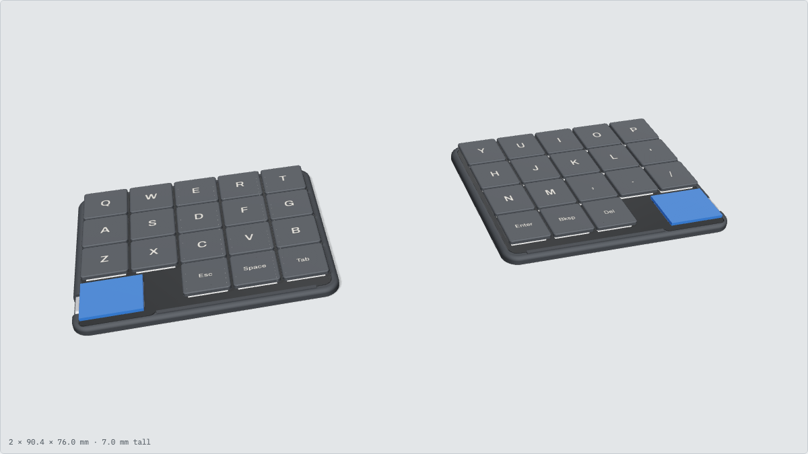
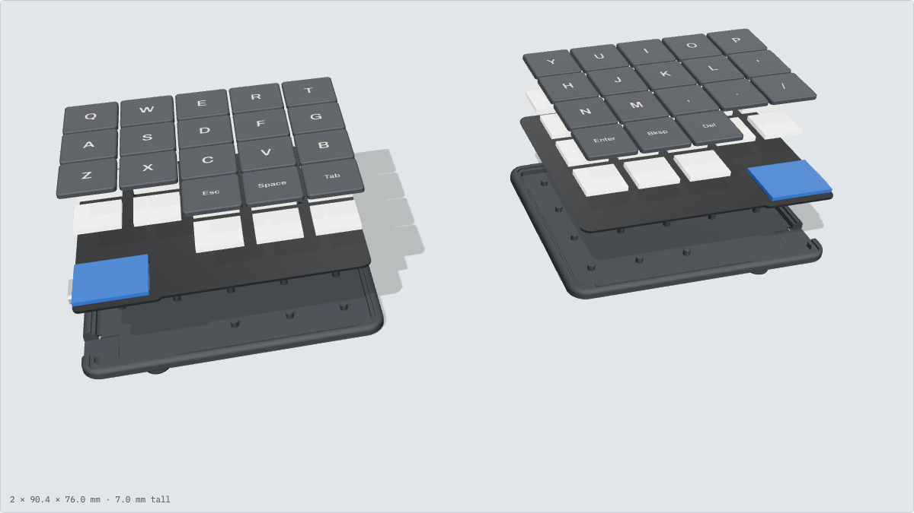
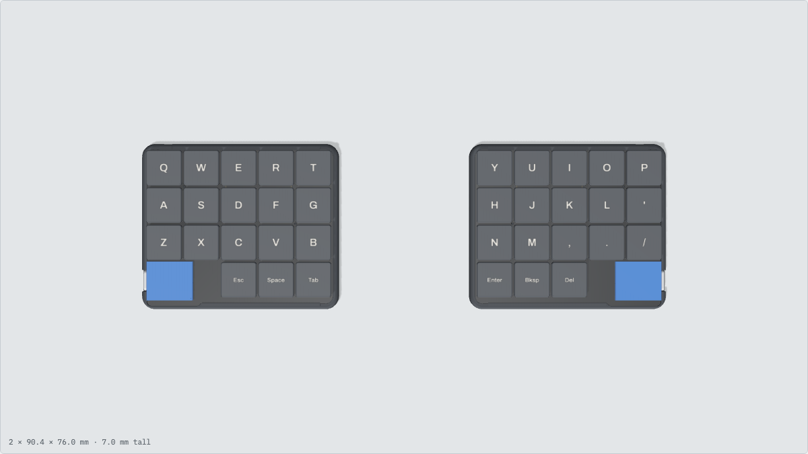
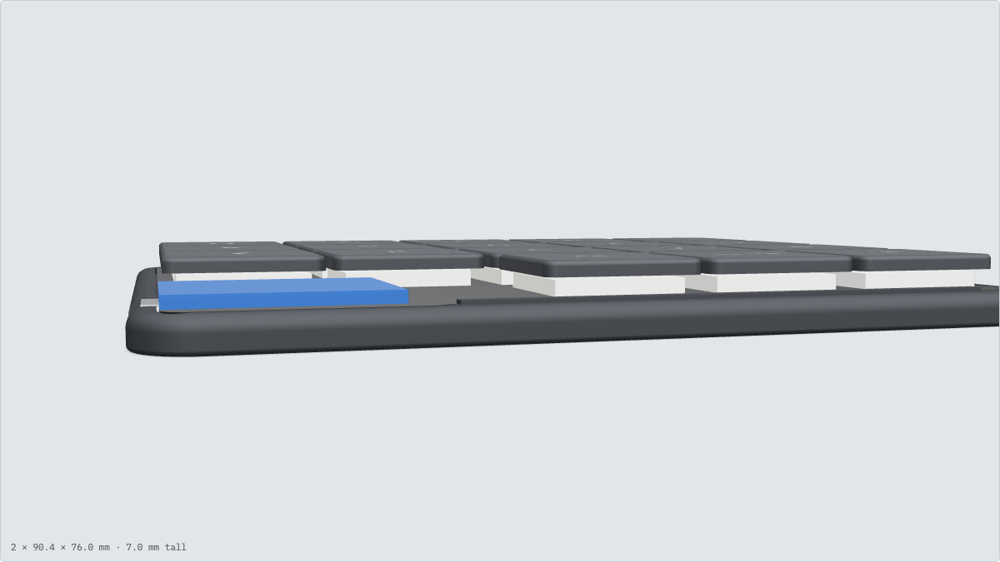
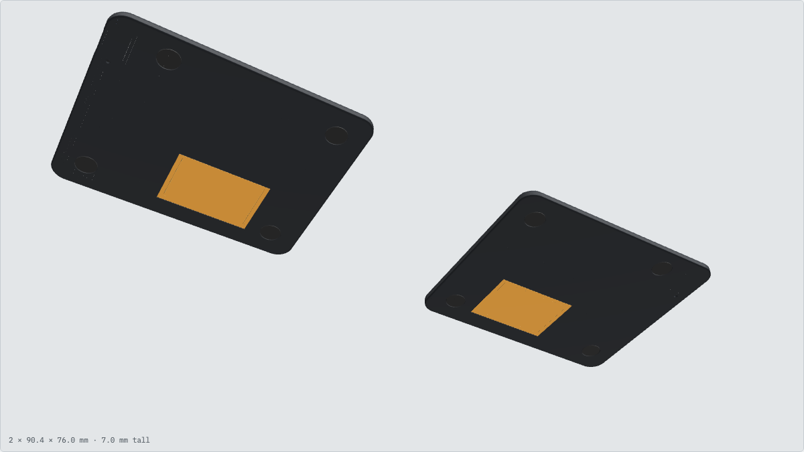
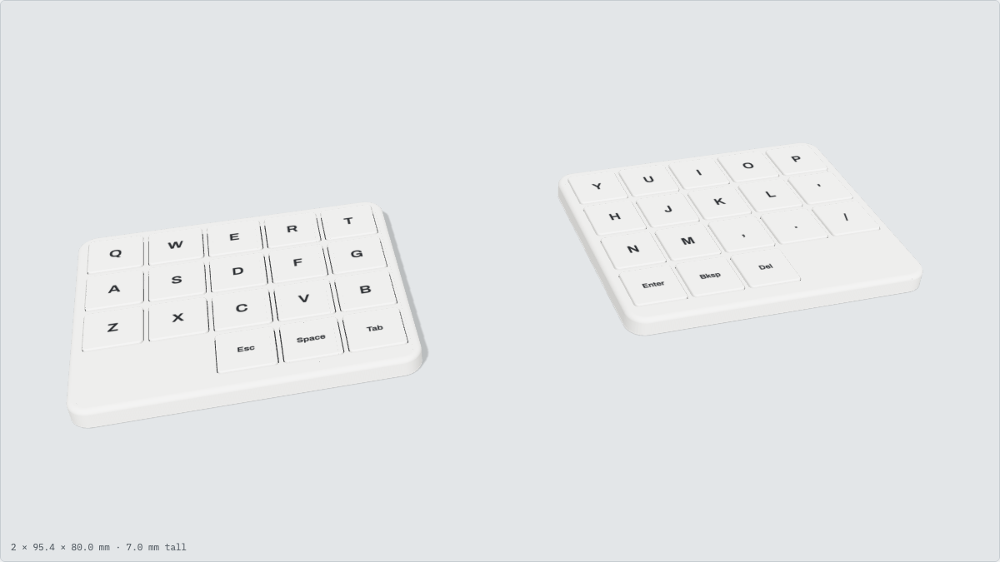
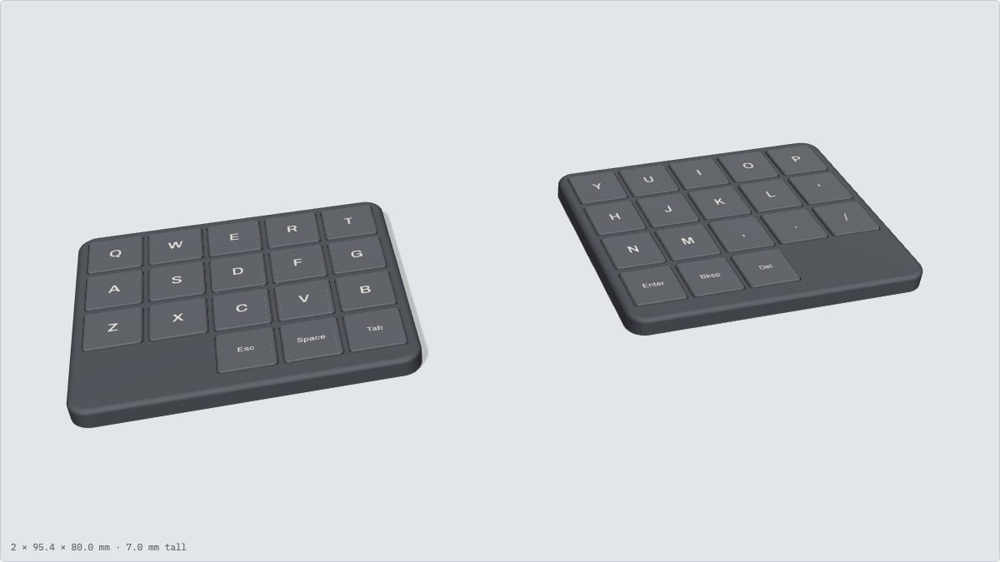
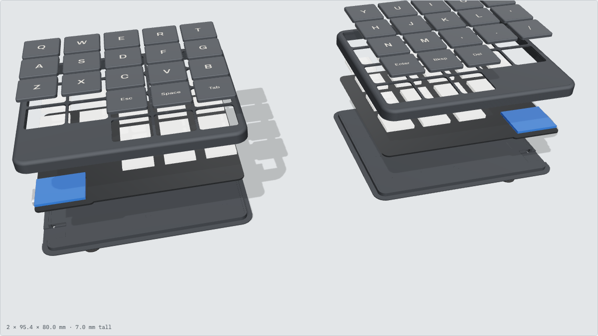
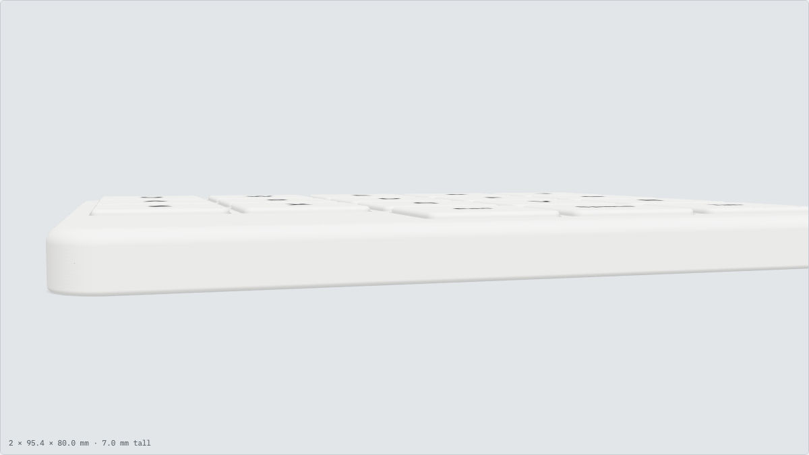

# 3D model

Renders of the concept model from <code>hardware/case/keyboard.py</code>. The open tray is the locked design; the enclosed case is a concept at 18 mm pitch. Regenerate the images with <code>node hardware/case/render.mjs</code>.

Colorway
<button class="chip" data-cw="graphite" aria-pressed="true">Graphite</button>
<button class="chip" data-cw="chalk" aria-pressed="false">Chalk</button>
<button class="chip" data-cw="signal" aria-pressed="false">Signal</button>

<figure class="shot">

<figcaption>Open tray, 3/4 view. 2 × 90.4 × 76.0 mm, 7.0 mm tall.</figcaption>
</figure>

<h3>Open tray views</h3>

<figure class="shot"><figcaption>Exploded: caps, switches, PCB, battery, tray.</figcaption></figure>
<figure class="shot"><figcaption>Top.</figcaption></figure>
<figure class="shot"><figcaption>Profile.</figcaption></figure>
<figure class="shot"><figcaption>Underside: battery pocket, XIAO pocket, reset pinhole.</figcaption></figure>

<h3>Enclosed concept</h3>

<figure class="shot"><figcaption>Chalk, 3/4 view.</figcaption></figure>
<figure class="shot"><figcaption>Graphite, 3/4 view.</figcaption></figure>
<figure class="shot"><figcaption>Exploded: top shell over bottom plate.</figcaption></figure>
<figure class="shot"><figcaption>Profile.</figcaption></figure>

<h3>Interactive</h3>

Orbit, explode and recolor the model. Loads about 5 MB.

<button class="chip" data-load="">Load open tray</button>
<button class="chip" data-load="?case=enclosed">Load enclosed</button>

The viewer is <a href="../viewer/index.html">cad/viewer/index.html</a>. It fetches the model, so it needs a web server: run <code>npm run build</code> then <code>npm run preview</code> and open <code>localhost:8000/ns-designer/</code>. Opened straight from disk, only the renders work.

